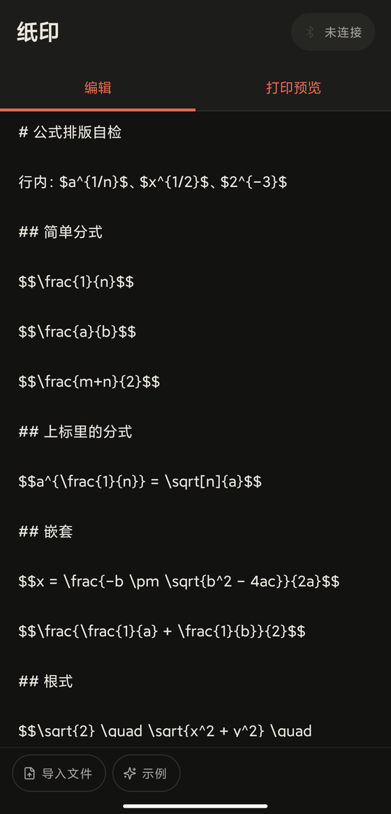
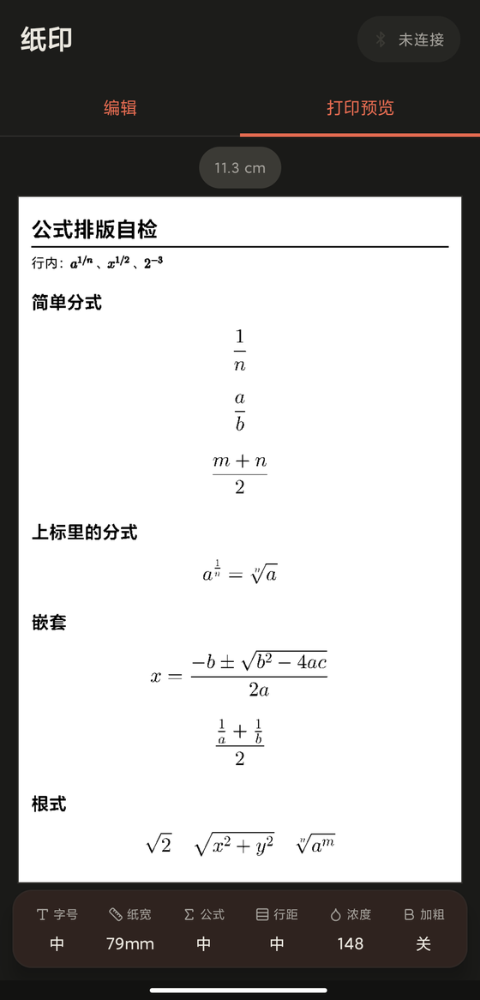
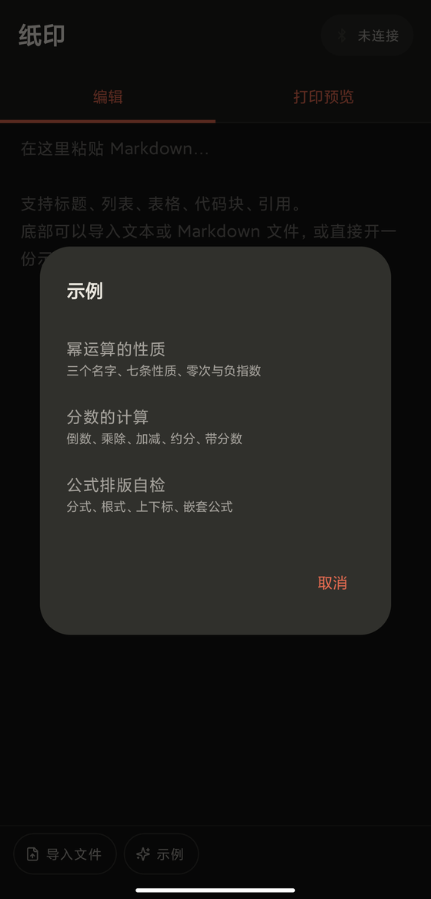

<div align="center">


# 纸印 · PaperInk

**Markdown straight onto thermal paper.**

Paste some Markdown, typeset it locally into a bitmap, and send it over Bluetooth
to the print head. No vendor app, no network, no account.





</div>

## What it does

- **Type and preview**: paste or import `.txt` / `.md`, see the printed result immediately
- **Real typesetting**: headings, lists, tables, code blocks, quotes, bold/italic, rules
- **Formulas**: inline `$…$` and display `$$…$$`; fractions, radicals and scripts are
  laid out by JLaTeXMath itself — not pictures
- **Tuned to the paper**: 57 / 68 / 79 mm roll widths; size, spacing, density and
  bold are four independent dials
- **Long-press to save**: hold the preview to store the current bitmap as a PNG
- **Bluetooth only**: no `INTERNET` permission — your text never leaves the device
- **Two languages**: English and Chinese, following the system language
  (Android 13+ can set it per app: Settings → Apps → PaperInk → Language)

## Supported hardware

Verified on a **Paperang P3 MAX** (300 dpi, 79 mm / 864 dots). Four protocols are
built in and detected automatically:

| Protocol | Where it shows up |
|---|---|
| Paperang (legacy) | P3 series, `0x02 … 0x03` frames |
| CatProtocol | "Miaomiao" printers, `0x51 0x78` frames |
| A5 | batches with a different MCU; different MTU and handshake |
| ESC/POS raster | generic thermal printers, `GS v 0` |

Other models will probably print, but they have not been tested.

## Build

Needs JDK 17 and Android SDK 36 (`compileSdk = 36`, `minSdk = 26`).

```bash
git clone https://github.com/moevis/paperink.git && cd paperink
./gradlew :app:assembleDebug          # app/build/outputs/apk/debug/app-debug.apk
./gradlew :app:testDebugUnitTest      # 23 unit tests
```

Install it on your own device:

```bash
adb install -r app/build/outputs/apk/debug/app-debug.apk
```

The `sdk.dir` in `local.properties` and the JDK path in `~/.gradle/gradle.properties`
are machine-specific — do not commit them. Release signing uses `keystore.properties`
in the repository root (also not committed); without it a release build falls back to
the debug signing key so the APK is still installable:

```properties
storeFile=/absolute/path/to/release.jks
storePassword=…
keyAlias=…
keyPassword=…
```

### Releases from GitHub

Pushing a `v*` tag builds a signed APK and publishes it as a GitHub Release:

```bash
git tag v1.0.0 && git push origin v1.0.0
```

The [release workflow](.github/workflows/release.yml) reads the version from the tag,
runs the same size check and unit tests as CI, then uploads `paperink-<version>.apk`
to the Release page. To sign with your own key, add four repository secrets:
`KEYSTORE_BASE64` (base64 of the `.jks`), `KEYSTORE_PASSWORD`, `KEY_ALIAS` and
`KEY_PASSWORD`. Without them the APK is signed with the debug key — installable,
but not upgradeable over a differently signed build.

## How the code fits together

```
Markdown text
   │  md/MarkdownParser.kt      splits into blocks and inline elements, no layout
   ▼
Doc
   │  render/LayoutBuilder.kt   block layout: where every piece goes
   │  render/InlineSpans.kt     inline markup → styled text
   │  render/JlmMath.kt         hands formulas to JLaTeXMath
   │  render/PrintRenderer.kt   draws, binarises, packs the rows
   ▼
Monochrome bitmap (576 / 720 / 864 dots wide)
   │  bt/PrinterClient.kt       connects and identifies the protocol
   │  bt/print/                 one file per protocol
   ▼
Thermal printer
```

| Directory | What lives there |
|---|---|
| `bt/` | Bluetooth connection, protocol detection, four sets of print commands |
| `md/` | Markdown → `Doc`; pure JVM, unit-testable |
| `render/` | `Doc` → monochrome bitmap; formulas, tables and pagination |
| `ui/` | The Compose screens, one file per screen |
| `file/` | Import encoding detection, PNG export |
| `samples/` | Three built-in samples, packaged as assets at build time (`samples/en/` holds the English ones) |

## Known limitations

- Only tested on a P3 MAX; no other model has been verified on real hardware
- **Inline fractions are set as `a/b`**: TeX's text style shrinks numerator and
  denominator to 0.43em, which turns to mush once a 300 dpi thermal head
  binarises it. Write `\dfrac{}{}` for a stacked fraction — that one is left alone
- Some lines still sit taller than the body text (the descender of the math slash)
- Saved PNGs go to the app's private directory, not the gallery
- The **samples** are maths notes: they demonstrate typesetting, not document
  design

## Licence

Released under the **GPL-3.0**; the full text is in [LICENSE](LICENSE). It is GPL
because the formula engine (JLaTeXMath) is GPL to begin with, and following it
keeps the whole thing consistent.

Third-party components:

| Component | Licence |
|---|---|
| [JLaTeXMath-Android](https://github.com/noties/jlatexmath-android) | GPL-2.0 **or later**, with a Classpath exception |
| [commonmark-java](https://github.com/commonmark/commonmark-java) | BSD-2-Clause |
| [Lucide](https://lucide.dev) | ISC |
| AndroidX / Jetpack Compose | Apache-2.0 |

---

# 中文

**把 Markdown 打到热敏纸上。**

粘贴一段 Markdown，本地排成位图，蓝牙直接发给打印头。
不需要官方 App，不联网，不登录。

## 能做什么

- **编辑即预览**：粘贴、导入 `.txt` / `.md`，右边立刻看到打印出来的样子
- **真的排版**：标题、列表、表格、代码块、引用、粗体斜体、分隔线
- **公式**：行内 `$…$` 与独立 `$$…$$`，分式、根号、上下标由 JLaTeXMath 真排，不是图片
- **按纸调**：57 / 68 / 79 mm 三档纸宽，字号、行距、浓度、加粗四档可分调
- **长按存图**：在预览上长按，把当前位图存成 PNG
- **只申请蓝牙权限**：没有 `INTERNET`，稿子不会离开这台机器
- **中英双语**：跟随系统语言（Android 13+ 可单独设置：设置 → 应用 → 纸印 → 语言）

## 支持的机器

在 **Paperang P3 MAX**（300dpi，79mm / 864 点）上验证过。协议层内置四套并自动识别：

| 协议 | 用在哪 |
|---|---|
| Paperang（老协议） | P3 系列，`0x02 … 0x03` 帧 |
| CatProtocol | 喵喵机，`0x51 0x78` 帧 |
| A5 | 换过主控的批次，MTU 与握手不同 |
| ESC/POS 光栅 | 通用热敏机，`GS v 0` |

别的型号大概率能出纸，但没实测过。

## 构建

需要 JDK 17 与 Android SDK 36（`compileSdk = 36`，`minSdk = 26`）。

```bash
git clone https://github.com/moevis/paperink.git && cd paperink
./gradlew :app:assembleDebug          # app/build/outputs/apk/debug/app-debug.apk
./gradlew :app:testDebugUnitTest      # 23 项单元测试
```

装到自己的机器上：

```bash
adb install -r app/build/outputs/apk/debug/app-debug.apk
```

`local.properties` 里的 `sdk.dir` 与 `~/.gradle/gradle.properties` 里的 JDK 路径都由本机决定，
不要提交。发版签名靠仓库根的 `keystore.properties`（同样不入库）；没有它时 release 会退回
debug 签名，出的包照样能装：

```properties
storeFile=/absolute/path/to/release.jks
storePassword=…
keyAlias=…
keyPassword=…
```

### 从 GitHub 发版

推一个 `v*` 的 tag，就会自动构建签名 APK 并发布成 GitHub Release：

```bash
git tag v1.0.0 && git push origin v1.0.0
```

[发版流水线](.github/workflows/release.yml) 从 tag 里取版本号，跑跟 CI 一样的行数检查与
单元测试，然后把 `paperink-<版本号>.apk` 挂到 Release 页上。要用自己的密钥签名，在仓库的
Secrets 里加四项：`KEYSTORE_BASE64`（`.jks` 的 base64）、`KEYSTORE_PASSWORD`、`KEY_ALIAS`、
`KEY_PASSWORD`。没配就用 debug 密钥签名——能装，但和别的签名包的版本互相盖不掉。

## 代码怎么走

```
Markdown 文本
   │  md/MarkdownParser.kt      切成块与行内元素，不碰排版
   ▼
Doc
   │  render/LayoutBuilder.kt   块级排版：每块摆哪儿
   │  render/InlineSpans.kt     行内标记 → 带样式的一段文字
   │  render/JlmMath.kt         公式交给 JLaTeXMath
   │  render/PrintRenderer.kt   画字、二值化、按行打包
   ▼
单色位图（576 / 720 / 864 点宽）
   │  bt/PrinterClient.kt       连机器、认协议
   │  bt/print/                 一套协议一个文件
   ▼
热敏打印机
```

| 目录 | 干什么 |
|---|---|
| `bt/` | 蓝牙连接、协议识别、四套打印指令 |
| `md/` | Markdown → `Doc`，纯 JVM，可单测 |
| `render/` | `Doc` → 单色位图；公式、表格、分页都在这里 |
| `ui/` | Compose 界面，一个文件管一屏 |
| `file/` | 导入文件的编码探测、PNG 导出 |
| `samples/` | 三个内置示例，构建时直接当 asset 打包（`samples/en/` 是英文版） |

## 已知限制

- 只在 P3 MAX 上跑通过，其余机型没有实机验证
- **行内分式排成 `a/b`**：TeX 的 text style 会把分子分母压到 0.43em，热敏纸 300dpi 二值化后直接糊掉。
  想要上下堆叠，写 `\dfrac{}{}`，那个不会被改写
- 行高比正文字高一截的情况仍存在（数学字体的斜杠有下降部）
- 保存的 PNG 在应用私有目录，没进相册
- **内置示例是数学讲义**：演示的是排版能力，不是文档设计

## 许可

代码以 **GPL-3.0** 发布，全文见 [LICENSE](LICENSE)。选它是因为公式引擎 JLaTeXMath 本身就是 GPL 系，
整个作品跟着走最省心。

第三方组件：

| 组件 | 协议 |
|---|---|
| [JLaTeXMath-Android](https://github.com/noties/jlatexmath-android) | GPL-2.0 **或更高**，带 Classpath 例外 |
| [commonmark-java](https://github.com/commonmark/commonmark-java) | BSD-2-Clause |
| [Lucide](https://lucide.dev) | ISC |
| AndroidX / Jetpack Compose | Apache-2.0 |
